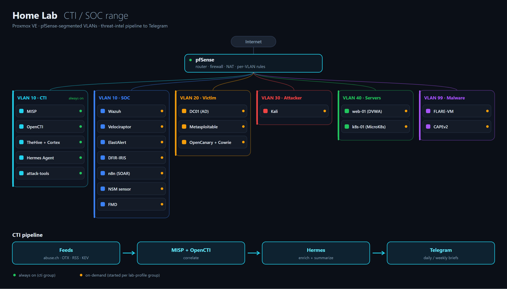
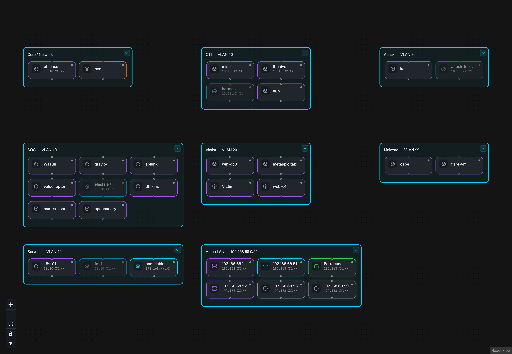

# Home Lab

Proxmox VE 9.2 on a Lenovo ThinkCentre M710q (4 cores, 32 GB RAM). Lab networks sit behind pfSense on separate VLANs.



Live view of the same lab, segmented by VLAN, in [Homelable](https://github.com/Pouzor/homelable):



## Machines

Group = the `lab-profile` group that starts and stops it. See [infrastructure/proxmox](infrastructure/proxmox/README.md).

| ID | Name | Type | Group | What it does | Docs |
|---|---|---|---|---|---|
| 100 | pfsense | VM | cti | Router, firewall, NAT for every lab VLAN | [network/pfsense-suricata](network/pfsense-suricata/README.md) |
| 101 | wazuh | VM | soc, purple | Main SIEM. Agents on the Linux VMs, DC01 and the NSM sensor | [siem/wazuh](siem/wazuh/README.md) |
| 102 | velociraptor | VM | soc, purple | DFIR and hunting server. Clients on every Linux machine | [dfir/velociraptor](dfir/velociraptor/README.md) |
| 103 | elastalert | LXC | soc | Alert rules on the Wazuh indexer | [siem/elastalert](siem/elastalert/README.md) |
| 104 | dfir-iris | VM | soc | Forensic case management | [dfir/dfir-iris](dfir/dfir-iris/README.md) |
| 105 | win-dc01 | VM | purple, attack | Active Directory domain controller | [infrastructure/active-directory](infrastructure/active-directory/README.md) |
| 106 | web-01 | VM | attack | Vulnerable web app (Apache, ModSecurity, pingapp) | [web-app](web-app/README.md) |
| 107 | kali | VM | purple, attack | Attack box | [adversary-simulation](adversary-simulation/README.md) |
| 108 | metasploitable2 | VM | attack | Intentionally vulnerable target | [adversary-simulation/metasploit](adversary-simulation/metasploit/README.md) |
| 109 | n8n | VM | soc | SOAR workflows | [threat-intel/n8n-soar](threat-intel/n8n-soar/README.md) |
| 111 | misp | VM | cti | Threat intel feeds, sharing, enrichment modules | [threat-intel/misp](threat-intel/misp/README.md) |
| 112 | thehive | VM | cti | OpenCTI 7, TheHive 6, Cortex 4 | [threat-intel/opencti](threat-intel/opencti/README.md), [dfir/thehive-cortex](dfir/thehive-cortex/README.md) |
| 114 | nsm-sensor | VM | nsm | Zeek and Suricata 8 with JA4 on a mirror of all pfSense LAN traffic | [network/nsm-sensor](network/nsm-sensor/README.md) |
| 115 | k8s-01 | VM | k8s | MicroK8s with Falco, Fluent Bit, Trivy; kubernetes-goat security scenarios | [infrastructure/kubernetes](infrastructure/kubernetes/README.md) |
| 116 | flare-vm | VM | malware | Windows malware analysis workstation (Mandiant FLARE-VM) | [malware-analysis/flare-vm](malware-analysis/flare-vm/README.md) |
| 117 | cape | VM | malware | CAPEv2 automated sandbox, detonates samples in a nested Windows guest | [malware-analysis/cape](malware-analysis/cape/README.md) |
| 118 | opencanary | VM | soc | OpenCanary and Cowrie honeypots | [deception/opencanary](deception/opencanary/README.md) |
| 120 | hermes | LXC | cti | Hermes Agent: daily and weekly CTI briefs to Telegram, IOC lookups | [threat-intel/hermes](threat-intel/hermes/README.md) |
| 121 | attack-tools | LXC | purple, attack | ATT&CK Navigator, Attack Flow builder, DeTT&CT | [adversary-simulation/attack-tools](adversary-simulation/attack-tools/README.md) |
| 122 | homelable | LXC | always on | Homelab visualizer: Proxmox topology import, live status, documentation | — |
| 123 | barracuda | LXC | always on | Maps CTI report text to MITRE ATT&CK techniques (sentence-transformers) | — |
| 125 | sof-elk | VM | on-demand | SOF-ELK DFIR/forensics ELK appliance (needs the cti group stopped for RAM) | — |

## Lab groups

32 GB of RAM cannot run everything at once. `lab-profile` on the Proxmox host starts and stops machines in groups. Only `cti` starts with the host. Start one other group when you need it and stop it when done.

| Group | Machines | RAM on top of cti | What it is for |
|---|---|---|---|
| cti | pfSense, MISP, OpenCTI/TheHive/Cortex, Hermes | (about 23 GB) | Always on. Routing, threat intel feeds, case management, daily briefs to Telegram |
| soc | Wazuh, Velociraptor, ElastAlert, DFIR-IRIS, n8n, OpenCanary | about 10 GB | SIEM, hunting, forensics, SOAR and honeypots |
| purple | Wazuh, Velociraptor, DC01, Kali, attack-tools | about 12 GB | Purple team: attack DC01 and check what was detected, plan and score in Navigator and DeTT&CT |
| attack | Kali, DC01, Metasploitable2, web-01, attack-tools | about 9 GB | Offensive practice against every target, no SIEM running |
| malware | FLARE-VM, CAPE | 4 GB and 6 GB | Malware analysis on the malware VLAN, which has no internet |
| k8s | k8s-01 | 6 GB | Kubernetes, Falco runtime alerts, Trivy scans |
| nsm | nsm-sensor | 4 GB | Zeek and Suricata on everything crossing pfSense |

### Commands

Run on the Proxmox host.

```bash
lab-profile status              # every group, every machine, free host RAM
lab-profile <group> start       # checks free RAM first, asks if it will not fit
lab-profile <group> stop        # clean shutdown, forced after 120 seconds
lab-profile reset               # stop everything except cti
```

### Common sessions

| Session | Commands | Then |
|---|---|---|
| Morning intel | nothing, cti is always on | Read the daily brief in Telegram, open OpenCTI or MISP for anything worth a closer look |
| Purple team | `lab-profile purple start` | Pick techniques in Navigator, run them from Kali or with Atomic Red Team on DC01, check Wazuh and Velociraptor, score the result in DeTT&CT |
| SOC practice | `lab-profile soc start` | Work Wazuh alerts, hunt in Velociraptor, open cases in DFIR-IRIS or TheHive, watch honeypot hits |
| Network hunt | `lab-profile nsm start` | Run traffic from any group, read Suricata alerts and Zeek logs (JA4, DNS, TLS) on the sensor |
| Malware triage | `lab-profile malware start` | Submit the sample to CAPE first, open the report, dig into anything interesting by hand on FLARE-VM |
| Detection on Kubernetes | `lab-profile k8s start` | Run attacks against the cluster, watch Falco alerts |
| Back to normal | `lab-profile reset` | Only cti stays up |

## Folders

```
architecture/            Network layout, data flow
infrastructure/
  proxmox/               Host, storage, lab-profile groups
  active-directory/      DC01
  kubernetes/            k8s-01
  tailscale/             Remote access
  monitoring/            Lab health check, Telegram alerts
siem/                    wazuh, elastalert
dfir/                    velociraptor, dfir-iris, thehive-cortex
threat-intel/            opencti, misp, hermes, ioc-export, feeds, n8n-soar
network/                 pfsense-suricata, nsm-sensor, wireshark
deception/               opencanary, Azure-HoneyPot, GCP-HoneyPot
adversary-simulation/    kali tools, metasploit, ad-attacks, attack-tools
malware-analysis/        flare-vm, cape
web-app/                 web-01
```
